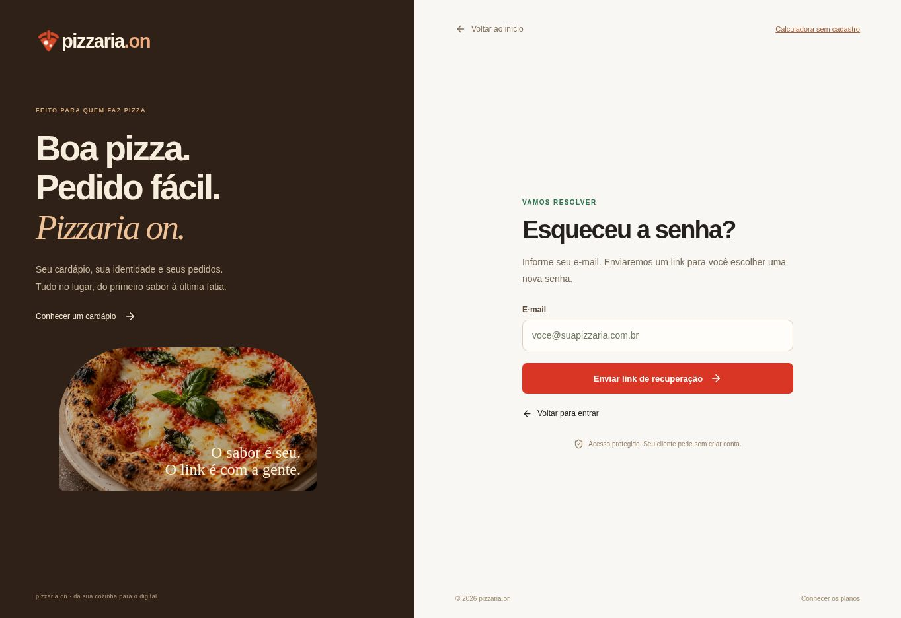

# Auditoria de acesso e continuidade — 26/10/2026

## Continuidade recuperada

Foram recuperadas as mensagens relevantes e as últimas decisões do chat “Verificar recuperação de conta”, também chamado de recuperação de senha. Não há uma transcrição integral disponível nesta integração; não declarar leitura literal de mensagens ou anexos não retornados.

O atendimento registrou que o link anterior abria a página normal, configuração de SMTP Gmail/modelo de recuperação no Supabase e confirmação de envio às 12h20 de Brasília. A busca anterior não encontrou confirmação de conclusão. Na orientação mais recente, o proprietário confirmou que recebe o e-mail e relatou que o link abre o site normal. Isso confirma entrega relatada pelo titular; troca de senha e novo login no aparelho continuam por comprovar. A conversa comercial posterior não constitui ensaio do produto. O último pedido é aprofundar cadastro, login, recuperação, uso, publicação, pedido, WhatsApp, Pix e administração, preservando as contas e sem pedidos/cobranças reais.

As PRs #131 (atalho administrativo para o provedor), #132 (horários no cardápio e configuração) e #133 (jornadas móveis e horários no navegador) foram integradas à main enquanto a correção de retomada era preparada. Todas foram conservadas. A consulta inicial encontrou a versão Sites 100; a publicação final está registrada abaixo.

## Evidência atual

- Projeto Supabase consultado: `ACTIVE_HEALTHY`. Logs foram consultados somente em agregados por ação/status, sem expor identificadores, tokens, mensagens, IPs ou e-mails de clientes. Os registros confirmam solicitações de recuperação no período, sem demonstrar que o cliente completou a troca e entrou.
- Antes da publicação, a página pública `/esqueci-senha` foi aberta no navegador: informava que a recuperação por e-mail estava indisponível e oferecia atendimento por WhatsApp. Configurar SMTP no provedor não ligava automaticamente essa opção no aplicativo. A liberação foi confirmada no navegador após publicar a versão 101.
- O código já aceita token hash na rota `/redefinir-senha` e código PKCE com cookie do navegador que iniciou a solicitação. A sessão de recuperação tem finalidade restrita e não abre o painel, publica, altera cardápio, lê clientes ou aprova pedidos.
- O modelo de recuperação versionado ainda usava `ConfirmationURL`, que no envio manual do painel pode não indicar a rota de nova senha. O modelo foi alinhado ao endereço explícito `SiteURL/redefinir-senha?token_hash=TokenHash`. Isso também atende abertura em outro navegador. SMTP, remetente e credenciais de produção foram preservados. Após a confirmação explícita do proprietário de que o e-mail chega, `PEDIDO_EMAIL_DELIVERY_READY=true` foi aplicado na publicação 101 (ambiente revisão 20).

## Correções

O formulário de acesso agora permite repetir a consulta de configuração sem recarregar a página, limita o tempo das requisições e impede envios simultâneos. Uma queda durante cadastro ou troca de senha apresenta resultado incerto com orientação para conferir antes de reenviar; não há repetição automática. Respostas HTML/inválidas do gateway viram mensagens compreensíveis. A senha sai do estado do formulário após confirmação da alteração e não vai para armazenamento do navegador.

Foi mantida a regra: cadastro direto sem confirmação de e-mail; autenticação real no servidor; senha atual exigida para alteração em sessão comum; recuperação validada pelo provedor para quem perdeu o acesso. O administrador não visualiza senhas. O atalho Supabase existente exige a conta administradora do provedor e não concede acesso novo.

## Matriz de validação

| Jornada | Cobertura nesta revisão | Limite |
|---|---|---|
| Cadastro | Rotas com SQLite/migrações reais, identidade externa simulada; cartão de cadastro no Chrome | Não cria conta real nem dispara confirmação |
| Login e logout | Erro, retorno seguro, persistência, renovação concorrente, sessão revogada e saída nas rotas; erro/sucesso do formulário no Chrome | Provedor e credenciais de ensaio são controlados |
| Recuperação | Token inválido/expirado/reutilizado, PKCE, outro navegador para token hash, sessão restrita, revogação das sessões antigas e login com senha nova nas rotas | Recebimento anterior relatado pelo proprietário; conclusão do novo fluxo com caixa postal real pendente |
| Nova senha | Link removido da URL, validação antes do editor, confirmação de senha, falha de rede, não persistência e um envio explícito | Respostas de API do ensaio de interface são simuladas |
| Cardápio | Edição, revisão, publicação, propriedade e recuperação local em ambiente isolado | Teste de turno em pizzaria real pendente |
| Pedidos/WhatsApp | Fluxo cliente/dono, loja sem verificação, mensagem interceptada, conversa e retomada | Sem mensagem externa ou cliente real |
| Pix | Comprovante, aprovação, isolamento, versões e comanda | Não houve Pix bancário; pagamento online automático ainda não implementado |
| Administração | Rotas com função de administrador e separação de titulares, UI no Chrome | Não ensaiar bloqueio ou alteração de senha de cliente real para provar o teste |
| Android/PWA | Service worker real no Chrome, rede cortada, congelamento/retomada e rascunho | Emulação, não Android físico nem reprodução conclusiva do print nativo |

## Pendências concretas

1. Com uma conta de teste controlada pelo proprietário, comprovar chegada do e-mail, abrir o link, escolher senha e entrar novamente. A liberação do envio acompanha esta correção com base na confirmação de recebimento do proprietário; falta documentar a conclusão do novo fluxo no aparelho. A conta do cliente atendido não foi usada nos novos ensaios.
2. Validar a PWA no Android físico alternando com WhatsApp e rede móvel. O print sem URL/aplicativo identificado não prova a origem da tela nativa de falha.
3. Primeiro recebimento externo de assinatura e homologação operacional de pedidos/impressora permanecem separados das verificações simuladas.

Nenhum e-mail externo, redefinição de senha de cliente, pagamento, mensagem de WhatsApp ou geração de IA paga foi executado nesta auditoria. A configuração SMTP relatada pertence ao atendimento anterior.

Fontes técnicas: [Supabase — senhas](https://supabase.com/docs/guides/auth/passwords), [modelos e TokenHash](https://supabase.com/docs/guides/auth/auth-email-templates), [Chrome — ciclo da página](https://developer.chrome.com/docs/web-platform/page-lifecycle-api).

## Publicação e verificação final

Versão **101** publicada com sucesso em 26/10/2026 às **16h51 UTC / 13h51 Brasília**, no mesmo projeto e público. Fonte Sites `6c99620c9fe8ff5612eff8f401dfcc641feac0f2`; árvore `ecab0aacb20b85769e419f55ce1c384953dee07e`, idêntica à árvore do commit de aplicação GitHub `2e02749c4ff0a3cca4917e0691f132445e6c7b27`. Artefato salvo com 676 arquivos, hash `sha256:9edf6ecf2db356f3ef8a37fe98bd97c8409b22717d9efca095540f2ce9b363fc`. Deploy `appgdep_6adf84f964f0819198bfe37c635d7fdb`, ambiente revisão 20. Nenhuma nova implantação Netlify.

**713 testes passaram**, sem falhas ou casos ignorados. TypeScript, build e verificação do gateway passaram. CI final do código:

- [Chrome 40361152397](https://github.com/bryansouzarodrigues1-creator/pedido.on/actions/runs/40361152397): sucesso. Jornada de acesso (8 verificações), acesso móvel (7), horários do dono (4), PWA (4), calculadora/admin (4), demais fluxos isolados e navegação pública. O artefato PWA registra zero gravações externas. A primeira execução do navegador revelou que trocar a URL pelo mesmo endereço com fragmento não recarregava a página offline: corrigido para recarga da própria rota, e cenário reexecutado com sucesso.
- [Windows 40361152544](https://github.com/bryansouzarodrigues1-creator/pedido.on/actions/runs/40361152544): sucesso na repetição do job. A primeira tentativa esgotou o prazo de uma captura sintética de cartões, antes da suíte de domínio; a repetição passou captura, TypeScript, regressão completa e build, sem alteração de código para mascarar a falha.
- [Autenticação e pedidos 40361152566](https://github.com/bryansouzarodrigues1-creator/pedido.on/actions/runs/40361152566), [conversa do pedido 40361152226](https://github.com/bryansouzarodrigues1-creator/pedido.on/actions/runs/40361152226) e [disponibilidade do cadastro 40361152655](https://github.com/bryansouzarodrigues1-creator/pedido.on/actions/runs/40361152655): sucesso.

No navegador público, após recarregar a publicação, `/esqueci-senha` mostrou e-mail e **Enviar link de recuperação**; `/redefinir-senha` sem token bloqueou a alteração e orientou solicitar o link. Um fragmento antigo fictício na raiz foi removido e encaminhado para `/redefinir-senha?error=legacy`, com orientação explícita e sem aceitar acesso. `/api/connection` respondeu `{"ok":true}`. A página inicial exibiu o benefício do cardápio e os três exemplos concretos. Os registros consultados após publicar não mostraram exceção nem HTTP 5xx; houve 404 de robô em `robots.txt`/`sitemap.xml`, sem falha da aplicação.

Esta comprovação não substitui a abertura de um **novo e-mail** e a conclusão da troca/login pelo proprietário, nem o ensaio em Android físico. O histórico novo de atividade começa nesta implantação; não inventa logins anteriores. O relato exato de erro de data continua sem tela/valor recuperáveis, embora as causas concretas de fuso, calendário e data inválida estejam corrigidas e testadas.
